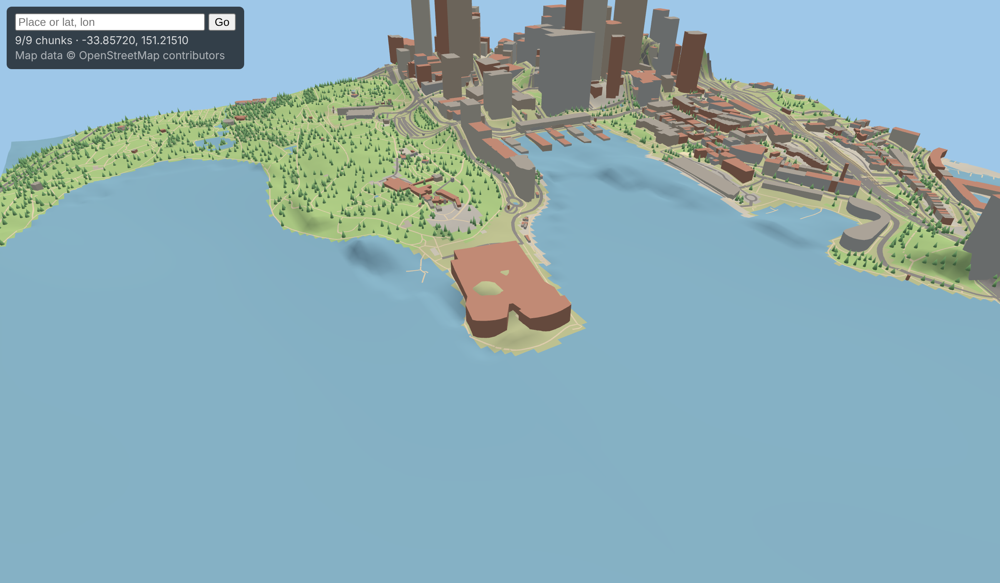

# EarthWalk

Walk anywhere on Earth with family and friends. The world is generated on the fly
from open data (OpenStreetMap for buildings, roads, parks and water; open elevation
tiles for terrain), and everyone in the same "room" can see each other and chat.



*Sydney Harbour as generated by the world server (shown in the browser preview).*

There are two parts:

- **`server/`**, the world server (Node.js). It downloads map data for the area you are
  in, turns it into 3D chunks, and runs the meetup rooms and chat. One server is shared
  by everyone who plays together.
- **`game/`**, the Unreal Engine game. It streams chunks from the server around you,
  lets you walk and fly, and shows the other people in your room.

The server also serves a **browser version** of the game at its own address, so someone
can join with nothing but a link. Browser and Unreal players share the same rooms.
Everyone appears as an animal of their choice.

## Status

- The server is working and tested (`npm test`), including against live map data.
- The browser client is working and tested with two players (`npm run e2e`). It needs
  a keyboard and mouse; there are no touch controls yet.
- The Unreal project has **not been compiled yet**. It was written without access to
  the engine, so expect a round of compile fixes the first time it is opened.

## Run the server

Needs Node.js 22.18 or newer.

On Windows, double-click `update-and-start.cmd` in the top folder: it fetches the latest
version, installs what the server needs, and starts it. Or by hand:

```bash
cd server
npm install
npm start
```

Then open http://localhost:8787 to play in the browser: enter a name, pick an animal,
and you are in. With Google sign-in turned on, **Sign in with Google** on that screen remembers
you on the device, gives you a home to start from and shows who else is online. (http://localhost:8787/viewer.html is a bird's-eye preview, and http://localhost:8787/figures.html shows how the players' animals move.) Useful
settings (environment variables):

| Variable | Purpose |
| --- | --- |
| `PORT` | Port to listen on (default 8787) |
| `EARTHWALK_ACCESS_CODE` | If set, players need this code to join and to load the world |
| `EARTHWALK_GOOGLE_CLIENT_ID`, `EARTHWALK_GOOGLE_CLIENT_SECRET`, `EARTHWALK_BASE_URL` | Turn on "Sign in with Google" (see [docs/HOSTING.md](docs/HOSTING.md)) |
| `EARTHWALK_INVITED` | Emails that may sign up with Google without the access code, comma-separated |
| `EARTHWALK_TRUST_PROXY` | Set to `1` when running behind a hosting provider's proxy |
| `EARTHWALK_CONTACT` | Contact shown to the OpenStreetMap services in the User-Agent, as their usage policies ask |
| `EARTHWALK_CACHE` | Where downloaded data and built chunks are kept (default `./cache`) |
| `EARTHWALK_OSM_SOURCES` | `overpass,osmapi` (default) or just one of them |
| `ANTHROPIC_API_KEY`, `EARTHWALK_TALK_MONTHLY_USD`, `EARTHWALK_TALK_MODEL` | Optional and paid: let the things players talk to answer through Claude, under a monthly limit (see [docs/HOSTING.md](docs/HOSTING.md)) |

For family in other homes to join, the server has to be reachable from the internet.
See [docs/HOSTING.md](docs/HOSTING.md) for putting it on a cloud host and inviting people.
The family server is at https://earthwalk.onrender.com.

## Play the Windows game

Family members do not need Unreal Engine. They install the game from one file:

1. Download the newest `EarthWalk-Setup-<version>.exe` from the
   [releases page](https://github.com/jasonhopkinstf-sketch/earthwalk/releases) and run it.
   It installs EarthWalk, the Windows components it needs, and a Start menu entry.
2. Start EarthWalk, press Enter, and type `/code <access code>` once (the person running
   the server has the code). Then either `/login` to sign in with Google (your browser opens;
   the game remembers you afterwards), or `/name <your name>` and `/animal <fox, bear, rabbit,
   cat, owl or frog>` to play as a guest.

To make that installer from this repository, see [docs/HOSTING.md](docs/HOSTING.md).

## Run the game in the editor

1. Install Unreal Engine 5 (5.4 or newer) with the Epic Games Launcher, and Visual
   Studio 2022 with the "Game development with C++" workload (Windows) or Xcode (Mac).
2. Close the Unreal editor if it is open, then double-click `game/build.cmd`. It finds the
   engine, fetches the latest version, and compiles the game. If the build fails it
   opens `game/build-log.txt` with the reasons.
3. When it succeeds, say yes to open the project, then press Play. You start at the
   Eiffel Tower.
4. The game connects to the family server by default. Type `/code <access code>` once
   (press Enter first to open the chat box). To use a server on your own PC instead,
   type `/server http://localhost:8787`.

Controls (Unreal):

| Key | What it does |
| --- | --- |
| `W A S D` | Move |
| Left-drag the mouse, or `Left`/`Right` arrows | Look around (`Up`/`Down` tilt). The pointer stays free when you are not dragging, so a trackpad works |
| `2` / `1` | Run / walk (or hold `Shift` to run) |
| `V` | Camera view: first person, over the shoulder, far behind. Mouse wheel moves it closer or further |
| `Space` | Jump (walking) or rise (flying) |
| `F` | Toggle flying (`C` descends) |
| `E` | Hop on the horse, tractor, boat, car or train beside you; again to hop off. At a front door: go in, or out |
| `T` | Talk to the animal, car, train, tree or house beside you; `Esc` stops |
| `P` | Your passport (`/passport` does the same) |
| `Enter` | Chat and commands |

In the editor, click the game viewport once so it has the keyboard; `Shift+F1` gives the
mouse back to the editor. Houses with a known number get a letterbox, and street corners get
a sign post, where OpenStreetMap has the data.

Chat commands:

| Command | What it does |
| --- | --- |
| `/goto <place>` | Travel anywhere: `/goto Times Square`, `/goto 35.3606, 138.7274` |
| `/join <name>` | Go to someone in your room (or, when signed in, anyone online: it switches room) |
| `/who` | List who is in your room and, when signed in, everyone with an account: online or not, which room, and where on Earth |
| `/login`, `/logout` | Sign in with Google (the game opens your browser; the browser version has a button on its join screen) and forget the sign-in |
| `/home`, `/home <place>` | Signed in only: make where you stand (or a place) your home. You start there next time, on any device |
| `/invite` | Browser only: copy a link that lets someone join your room |
| `/name`, `/animal`, `/room` | Set your name, animal and room (saved on your account when signed in) |
| `/server`, `/code` | Unreal only: server address and access code (the browser asks on its join screen) |
| `/where`, `/fly`, `/help` | Coordinates, toggle flying, list commands |
| `/sound on`, `/sound off` | The animals' voices, car horns and train whistles |
| `/taxi <place>` | Call a taxi; it drives to you, and `E` beside it gets you a ride there |
| `/passport` | Your passport (the `P` key) |
| `/world auto`, `/world photo`, `/world generated` | Unreal only: our world on foot and Google's photographic 3D world from the air, the photographic world everywhere, or ours everywhere (see below) |
| `/mapskey <key>` | Unreal only: save a Google Map Tiles API key on this PC for the photographic world |

Project defaults live in `game/Config/DefaultGame.ini`.

## The photographic world (experiment)

The Unreal game can show Google's Photorealistic 3D Tiles as well as the generated world. It needs:

1. The free **Cesium for Unreal** plugin (2.28 or newer for UE 5.8), installed into the engine from Fab.
   `game/build.cmd` notices it and builds the game with it; without it the game builds and plays as
   before and `/world photo` says the plugin is missing.
   The standalone game made by `game\package.cmd` for the family installer always leaves the plugin
   out, so the photographic world is only in the game started from the editor build on a PC that has it.
2. A Google Cloud API key with the **Map Tiles API** enabled (billing must be on). Give it to the game
   with `/mapskey <key>` (saved on that PC only), `-EWMapsKey=<key>` on the command line, or
   `GoogleMapTilesKey` in `game/Config/DefaultGame.ini` (that one ships with the game, so do not commit it).

With both, there are three kinds of world, chosen with `/world <kind>` or `-EWWorld=<kind>`.
Ours is the default; the photographic kinds are there to be switched on:

- `auto`: our generated world on foot, the
  photographic one from the air. Fly up (F, then Space) and above 60 m over the ground the view changes
  to Google's tiles; come back below 45 m and ours returns. The tiles start loading out of sight from
  about 22 m up, and not at all for someone who stays on foot, so walking costs no Google request. The
  player only ever stands on our world. The heights are `PhotoAboveMeters` and `PhotoBelowMeters`
  in `game/Config/DefaultGame.ini`.
- `photo`: the tiles instead of our world, everywhere, walked on.
- `generated` (the default): ours everywhere, as without the plugin.

Google's attribution is drawn on screen by the plugin whenever tiles are being fetched. Other players
still appear. Our heights are above sea level and the tiles' above the ellipsoid, some tens of metres
apart: in `auto` the game measures the gap on the spot and moves the tiles to our heights; in `photo`
it does not, so someone in the other kind of world can appear above or below the street. Far from the
last teleport the two drift apart (the tiles follow the Earth's curve and our world is flat), by about
10 m at 10 km. The code is in `game/Source/EarthWalk/EarthPhotoWorld.cpp` and
`AEarthWorld::UpdateAerial`.

What to expect (checked on UE 5.8 with Cesium for Unreal 2.31 in November 2026):

- The tiles are aerial photogrammetry. From the air and across a city they look like the real place;
  from head height in a leafy suburb, trees and houses become large blurred slabs. That is the data at
  its finest, not a loading fault.
- The first visit to a place takes about half a minute to load; after that the plugin's cache
  (`game/cesium-request-cache.sqlite`, not committed) makes it a few seconds.
- In `photo` the player lands on the highest surface at that spot, which can be a roof.
- The tiles carry their own baked sunlight and are lit again by ours, so shade looks blue.
- Each session that shows or loads the tiles is one billable "root" request to Google; walking and
  flying around afterwards is not billed separately. `-EWPhotoStats` logs the plugin's loading statistics.

## How it fits together

See [docs/PROTOCOL.md](docs/PROTOCOL.md) for the chunk format and the meetup messages.
All world-generation logic is on the server, so it can be tested without the engine;
the game only uploads the meshes it receives.

`server/src/people.ts` holds the people system: guests (a typed name plus the access code)
and accounts (Google sign-in, remembered by a player token, with a home and a chosen animal),
stored as one JSON file under the cache directory. `server/src/presence.ts` joins that with
the rooms to say who is online and where. The access code doubles as the sign-up gate.

Animals: `server/src/life.ts` decides where they live and sends that with
the labels: herds on the map's meadows, paddocks and farmyards, ducks on ponds and rivers, pigeons
in town, a flock overhead, a cat or a dog beside some homes, rabbits, deer and squirrels, and a few
that belong to one part of the world (kangaroos, llamas, camels, penguins). The server also shares
its clock. `server/public/js/lifemotion.js` is the one rule for where each animal is at a moment,
so everyone in a room sees the same animal in the same place. `liferigs.js` says what each looks
like and `life.js` draws them and has them notice players: most look up and step aside, dogs trot
over, pigeons fly up. Their voices are made by code (`sounds.js`); there are no recordings.
docs/PROTOCOL.md, "Life", has the details.

Cars, tractors and boats: `server/src/traffic.ts` parks cars along streets
where people live and works out every trip a car makes, street by street and second by second, on
the side of the road the country drives on. `trafficmotion.js` replays a trip from the shared clock
and `traffic.js` draws the cars and has them stop and toot for a player in the way. Tractors work
ploughed fields and boats sail water near a shore; they circle a home like the animals do.
docs/PROTOCOL.md, "Traffic".

Trains: `server/src/rail.ts` fetches the railway tracks for a wide square of
the world, joins them into runs and timetables a train along each, stopping at stations. Every chunk
on a run sends the same train, and the browser replays it and whistles as it passes.
docs/PROTOCOL.md, "Trains".

Driving (in the browser so far): a car, a taxi or a tractor is driven, not ridden. W and S are the
pedals, A and D steer, Space is the handbrake, and the view moves to behind the car, where the
mouse looks round it. Speed builds and brakes, the steering is gentler the faster you go, the car
slides a little in a hard bend and a lot with the handbrake on, and a wall is a gentle bump
(`server/public/js/cardrive.js`, `player.js`).

Riding: press E beside a horse, a cow, a tractor, a boat, a parked car or a
passing train to hop on, and E again to hop off. You steer what you ride; a friend can hop on behind
you; a train carries you along its line. `server/public/js/riding.js` does it, the rooms keep track of
who is on what (`server/src/rooms.ts`), and docs/PROTOCOL.md, "Riding", has the messages.

Taxis: `/taxi the beach` calls one. A yellow cab comes along the road from a
few streets away and waits; hop on with E and it drives you there, by road when the place is close
and in one jump when it is not, saying odd and thoughtful things as it goes. Friends can share it.
`server/public/js/taxi.js`; docs/PROTOCOL.md, "Taxis".

Fifty-four kinds of animal now live in the world (`server/src/life.ts` places them,
`server/public/js/liferigs.js` draws them): farm animals, pets, wildlife, insects that flutter over
the grass, frogs and herons by the water, crabs and gulls on the sand, and the big animals of each
part of the world, from zebras and elephants to pandas, bison and reindeer. Each has a name and a
character to talk to, the larger ones can be ridden, and all of them can be told what to do.

Going into houses (the doors that open have a yellow COME IN sign over them in both games, and in
the Windows game `/house` says where the nearest is): press E at the front door of a house to go
in, and E again just inside it to come out. Most houses open, whatever their shape and on hillsides
too; an L-shaped or very big house gives its rooms the largest rectangle that fits inside it behind
the front door. Inside are rooms laid out from thirty recipes of our own
(`server/src/interior.ts`), stretched to fit: a hall or living room behind the door, then kitchens,
bedrooms, bathrooms, studies and playrooms, with doorways, windows and furniture. A house is the same inside for everyone, and friends who go in together see each other.
`server/public/js/houses.js`; docs/PROTOCOL.md, "Inside houses".

Treasure hunts and expeditions (in the browser so far): the passport starts a treasure hunt wherever
you stand. It is five riddles about real places nearby, taken from the map ("I have a bell but no
bicycle" is the church 250 metres to the south), with a chest of coins at the last, and friends who
start in the same neighbourhood that day get the same hunt. The passport also lists expeditions to
set out on: albums of animals to meet, tours of famous places, and lost animals to walk home to
their part of the world (`server/src/hunt.ts`, `server/src/expeditions.ts`).

Favours (in the browser so far): ask anything you talk to "can I help?" and it may ask a favour to
do with what it is. A horse wants a run, a cat a walk, a house has a parcel for another house, and
a tree that cannot leave its spot wants to hear what is down the road. Some ask without being
asked. Each pays coins, up to three can be open at once, and none can be failed
(`server/src/favours.ts`).

Daily tasks, coins and hats (in the browser so far): the passport lists three small tasks each day,
the same for everyone ("talk to a tree", "ride a kilometre on anything"). A task pays coins, all
three pay more, and coins buy hats that friends see on you; two hats can only be won, by doing all
three tasks on one day and on seven. Nothing can be failed and nothing runs out
(`server/src/daily.ts`, `server/public/js/hats.js`). This is the first of the games planned on top of
the passport: favours for the things you talk to, treasure hunts, races and a house of your own come
next.

Riddles and companions (in the browser so far): the passport has riddles, a few more at each level
("I carry my house on my back and leave a silver road behind me"). A riddle is solved out in the
world, by finding its answer and talking to it or riding it, and each one solved wins that animal
as a companion that follows you about, where friends can see it too. Thirty-four riddles so far
(`RIDDLES` in `server/src/journal.ts`; `server/public/js/pets.js`).

Telling things what to do: while talking to a thing, say "follow me", "come
here", "stay", "go home", "do a trick" or "make your noise", and it does. Riding a car, a tractor
or an animal, say "take me to the beach": a car drives itself there along the roads when the place
is close (`server/src/route.ts` finds the way), an animal cuts across country, and anywhere far is
one jump. Steering takes the reins back. Friends see all of it. `server/public/js/orders.js`;
docs/PROTOCOL.md, "Doing as asked".

A passport: press P. The server keeps a journal for every player of where
they have been, what they have ridden and whom they have talked to, and the passport shows it: a
level that rises with all of it, countries, continents, places, friends, and stamps that pop up as
they are earned (a first country, five kilometres on foot, a ride on a train, a chat with a tree).
A journal is its owner's alone, and a signed-in person's carries on from visit to visit
(`server/src/journal.ts`, `server/public/js/passport.js`; docs/PROTOCOL.md, "Journal").

Talking: press T beside an animal, a car, a train, a tree or a house and it
introduces itself; what you type then goes to it, and its answer appears in a speech bubble for
everyone nearby. Each thing has a name and a character of its own, the same for everyone
(`server/src/talk.ts`): some are cheerful, some grumble, some are campaigning for more puddles, and
all of them are friendly. With an API key on the server they answer through Claude; without one they
use their own stock of lines. `server/public/js/talk.js`; docs/PROTOCOL.md, "Talking".

Both games show where you are in a header at the top of the screen ("Islington, Greater
London"), asked from the server (`GET /v1/place`) whenever you have moved about a kilometre.

The Windows game shows the same animals, cars, tractors, boats and trains in the same places as the
browser, and makes the same sounds. `game/Source/EarthWalk/EarthLifeMotion.cpp` is the movement
rules of `lifemotion.js` and `trafficmotion.js` again in C++, and must give the same answers:
`node game/Tools/life-vectors.mjs <file>` prints test numbers from the JavaScript and the game run
with `-EWLifeTest=<file>` checks itself against them. `EarthLifeRigs.gen.inl` holds every figure,
written from `liferigs.js` by `node game/Tools/gen-life-rigs.mjs` (run it again when that file
changes). `EarthLife.cpp` is the counterpart of `life.js` and `traffic.js`: it draws everything
as four instanced meshes, whole and alive to players within 120 m and as simpler figures out to
400 m, and puts it all away while the photographic view from the air is up. `EarthSounds.cpp`
builds the voices of `sounds.js` as waves in code; `-EWSoundDump=<folder>` writes them as .wav
files to listen to.

Riding, talking, telling things what to do and the passport are in the Windows game as well.
`EarthCompany.cpp` is `riding.js`, `talk.js` and `orders.js` again in C++ (`EarthMounts.h` holds
what can be ridden); the player's own movement on a mount is in `EarthWalkCharacter.cpp`, the
speech bubbles, the line that says what E and T would do, and the passport are in
`EarthWalkHUD.cpp`, and the messages are read in `EarthWalkNet.cpp`. A player in one game can ride
along behind a player in the other. Taxis are in `EarthCompany.cpp` too (it draws one on its way
to whoever called it, by the shared clock). Going into houses is there and in `EarthWorld.cpp`:
the labels give the doors, and `OpenHouse` fetches the inside of a house the first time somebody
goes in and builds it inside the house's own walls, each sheet with a second face. Not in the
Windows game yet: the passport's riddles and the companions they win.

## Art assets and the look

The Unreal game is drawn as a barnyard cartoon: flat painted colours, light sorted into a few flat
levels, and ink outlines. All of it is generated by code, not made by hand:

- `game\Tools\build-assets.cmd` runs the `EarthWalkAssets` commandlet (`game/Source/EarthWalkEditor`),
  which builds the materials under `game/Content/EarthWalk`: painted ground, roofs and walls with
  drawn patterns (roof tiles, furrows, paving, grass strokes, patches of brick, cartoon windows),
  water, foliage, picket fences, the painted sky, and `M_EarthInk`, the post-process that flattens
  the light and draws the lines.
  The generated assets are committed, so this only needs running after changing the materials.
  There are no textures: every mark is worked out from where the surface is.
- Ground, roads and water take their colours from a palette in `AEarthWorld` (`StyleFor` in
  `EarthWorld.cpp`), one per surface id of the chunk format, in place of the server's own, which
  the browser still uses.
- Houses are the server's work (`server/src/chunk.ts`), so both clients get them: every building
  has its own wall and roof paint, and homes get a front door facing their street with a step and
  sometimes a porch, a chimney, and eaves that overhang. Farm buildings are barn red with wide
  doors. The Unreal game draws the windows: a few to a home, spaced to fit each wall, with a
  layout, width and glazing that differ house to house, and shutters or window boxes of flowers on
  some. The browser draws plainer ones, a row to a storey (`wallMaterial` in
  `server/public/js/world.js`).
- Houses are built in the style of where they are (`server/src/styles.ts`, about thirty-five
  styles chosen by rough boxes on the map, and by height above the sea for the mountain ones):
  brick and chimneys in England, dark brick and steep pantiles in the Netherlands, cream stone
  under grey mansards in Paris, ochre stucco under low terracotta in Italy, white cubes with blue
  doors on the Aegean islands, sand-coloured walls and flat roofs behind parapets from Morocco to
  Dubai, adobe in New Mexico, bright paint in Mexico and the Caribbean, deep eaves and dark tiles
  in Japan, brick and weatherboard bungalows with picket fences in Australia. A style sets the
  paints for walls, roofs and doors, how many houses are brick, the shape and steepness of roofs,
  how many houses have chimneys, and whether gardens have a hedge, a fence or a low wall. Anywhere
  without a style of its own gets a mixture.
- A home nobody measured is one or two storeys when it stands apart. Where buildings crowd
  together it becomes one of a street of town houses, and in a city centre part of a block of
  flats, as tall as that part of the world builds them (five to seven storeys in Paris, two or
  three in a Dutch town). Buildings with a mapped height keep it.
- Streets and gardens are the server's too: pavements beside streets where people live, a dashed
  line down the wider roads, and in front of homes a path to the street with a hedge or a white
  fence round most gardens. The Unreal game adds the small things near the player, which are not
  sent by the server: tufts of grass, patches of flowers and the odd stone (`AEarthGroundCover`),
  kept off roads and buildings by a map of what covers the ground (`AEarthWorld::CoverAt`).
- Trees and plants are the Unreal game's own (the server only says where a tree stands and how big
  it is): round crowns of several blobs, tall narrow trees, wide spreading ones, trees in blossom or
  hung with fruit, a few turning gold, and tiered or slim conifers (`AEarthChunkLabels::AddTree`).
  Near the player there are bushes, more of them under trees, and on farmland rows of wheat,
  cabbages or maize standing on the ridges between the drawn furrows, with the odd bale of straw.
  Everything leafy leans in the wind, by a few centimetres, in gusts that cross the land.
- The sky is painted on the inside of a great ball round the player (`AEarthSky`, `M_EarthSky`):
  pale at the horizon and deep overhead, a drawn sun where the light comes from, and rows of
  flat-bottomed clouds with an inked edge and a shaded underside, drifting slowly. The engine's
  atmosphere is still there for the haze over far land. `bPaintedSky` in
  `game/Config/DefaultGame.ini` turns it off (the engine's own clouds come back), and
  `-EWSky=Name:value,Name:value` tries other settings for one run (`Bright`, `CloudBright`,
  `Clouds`, `CloudInk`, `Drift`, `SunSize`).
- Garden fences are the server's thin panels, cut by the Unreal game into pales with pointed tops
  and gaps between them on two rails (`M_EarthFence`). Far away the gaps close and are drawn as
  lines. The browser shows the panels.
- The animal a player is seen as is jointed and moves itself, the same way in both games
  (`server/public/js/figuremotion.js` and, line for line, `EarthAnimalFigure.cpp`): it strides
  with swinging arms and leans into a run, the rabbit and frog hop, it breathes, blinks and looks
  about when standing, throws its arms up in a jump, stretches out to fly, and sits with its feet
  forward when riding. What another player is doing is worked out from how their figure moves, so
  nothing extra is sent. `/figures.html` on the server shows the six animals doing each thing
  (`?strip=fox&motion=run&view=side` is a film strip of one).
- `bInkOutlines` in `game/Config/DefaultGame.ini` turns the lines and flat light off. `InkTuning`
  there, or `-EWInk=Name:value,Name:value` for one run, changes the ink's settings (line width,
  the light levels and where they change, how far the effect reaches) without rebuilding anything.

For checking the look without playing, the game takes a screenshot and quits when started
with `-EWShot=<file.png>` (together with `-EWLat`/`-EWLon`/`-EWCode` as needed).
`-EWYaw=<compass degrees>` and `-EWPitch=<degrees>` point the player first, `-EWView=0|1|2` picks
the camera, `-EWWalk` walks forward, and `-EWShotUI` keeps the on-screen text in the picture.
`-EWFly=<metres>` starts flying that far above the ground and `-EWShotDelay=<seconds>` changes the
8 second wait before the picture. `-EWTimeShift=<seconds>` moves the game's clock for the animals,
cars and trains (to catch a train at a station), and `-EWLifeWhere=<time>` logs where each of them
is at that moment, to compare with the browser's `earthwalk.life.where(time)`. `-EWRide=<kind>`
hops on the nearest thing of that kind (`cow`, `car`, `train`...) a few seconds after landing,
`-EWTalk=<kind>` walks up to the nearest and says hello, `-EWSay=<words_with_underscores>` then
says that to it, and `-EWPassport` opens the passport. `-EWDoor` walks to the nearest front door that opens and goes
in, and `-EWTaxi=<place_with_underscores>` calls a taxi (with `-EWRide=taxi` the game hops on when
it has pulled up). While a screenshot is pending the game ignores the keyboard and
mouse, so typing in another window cannot move the player.

## Data and attribution

Map data © OpenStreetMap contributors, available under the Open Database License.
Terrain from the Terrain Tiles open dataset on AWS (Mapzen/Tilezen; sources include
SRTM, USGS 3DEP and others). The game shows the OpenStreetMap credit on screen; keep
it there if you change the interface.
